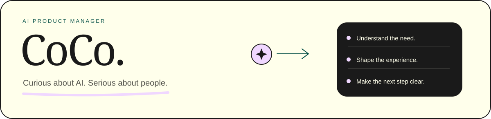

# 你好，我是 CoCo 小克克

**AI 产品经理 · UX/UI 背景**

关注人的需要，也探索技术的可能。这里收录我的项目、AI 产品探索和文章。

[个人网站 ↗](https://liyajing-product.github.io/) · [全部项目](#projects) · [技能标签](#skills) · [文章与思考](#writing)

## 技能标签

**产品与体验**

  
  
  
  

**AI 方向**

  
  
  
  

**项目技术栈**

  
  
  
  
  
  

## 全部公开项目

| 项目 | 展示内容 | 访问入口 |
| --- | --- | --- |
| **CoCo 小克克 · 个人网站** | AI 产品经理个人介绍、产品概念探索、产品思考与交互展示。 | [在线浏览](https://liyajing-product.github.io/) · [源码](https://github.com/liyajing-Product/liyajing-product.github.io) |
| **ALPINE · 电影感交互作品** | 围绕滑雪装备构建的五屏滚动叙事，包含视频、产品探索、结构拆解与装备目录。 | [在线体验](https://liyajing-product.github.io/keke-work/) · [源码](https://github.com/liyajing-Product/keke-work) |

### CoCo 小克克 · 个人网站

- **个人介绍**：展示 AI 产品定位、关注方向与工作思考。
- **产品探索**：CoPilot、知屿、日常之间三个概念方向，支持分类筛选和详情阅读。
- **产品思考**：围绕 AI 的使用价值、人机协作边界和交互方式整理观点。
- **页面实现**：响应式布局、原生 JavaScript 交互、GitHub Pages 发布。

### ALPINE · 电影感交互作品

- **SKIING 首屏**：视频场景与随滚动放大的字形转场。
- **雪镜产品探索**：多视角切换、镜片换色、镜片／镜框／镜带拆解。
- **雪板结构**：通过滚动查看板层、木芯、边刃、螺丝和固定器等结构。
- **Your style 场景**：银灰粒子云与滚动动效。
- **装备目录**：雪镜、头盔、夹克三类装备展示。
- **交互适配**：触屏与键盘操作，并提供减少动态效果的展示方式。

<strong>个人网站里的三个产品概念</strong>

这些是概念探索，不是已上线的独立产品。

| 概念 | 探索的问题 |
| --- | --- |
| **CoPilot** | 如何帮助用户澄清意图、拆解任务，从想法走向可推进的下一步？ |
| **知屿** | 如何让分散的笔记、收藏与知识，在具体任务中重新连接、发挥作用？ |
| **日常之间** | 如何在合适的时刻提供刚刚好的 AI 帮助，减少日常操作负担？ |

[在个人网站查看概念详情 ↗](https://liyajing-product.github.io/#work)

[浏览账号下全部仓库 ↗](https://github.com/liyajing-Product?tab=repositories)

## 文章与思考

<!-- ARTICLES:START -->
我在微信公众号记录设计、AI 协作与用户体验相关的思考。点击标题阅读原文。

| 文章 | 主题 |
| --- | --- |
| [设计师如何开启“闪身步”，跨进 AI 协作的？](https://mp.weixin.qq.com/s/5eyHKqee3ugK-3LQpiS2dQ) | 设计师 × AI 协作 |
| [天天听 OpenAI 和 Anthropic，你真的知道它们在干什么吗？](https://mp.weixin.qq.com/s/jY4_teuCqTO_8zkjRIHpDg) | AI 公司与生态 |
| [AI 的加入，快把设计师逼疯了～](https://mp.weixin.qq.com/s/-A5UZFXLqA5byEXMKa76lA) | AI 与设计实践 |
| [AI 时代UX的变化有多大？](https://mp.weixin.qq.com/s/qergtIq6u9wqnYWHxTI-wg) | UX 与 AI |
<!-- ARTICLES:END -->

---

**保持好奇，认真创造。**

[个人网站](https://liyajing-product.github.io/) · [GitHub](https://github.com/liyajing-Product) · [主页源文件](https://github.com/liyajing-Product/liyajing-Product)
